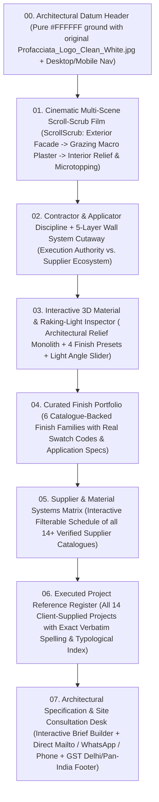

# PROFACCIATA — MASTER PROMPT 01
## Repository Audit, Creative Direction & 3D Experience Planning

> **Phase Status:** Audit & Architecture Plan Complete (Zero project files modified, added, or deleted).  
> Throughout this document, **[OBSERVED FACT]** denotes verified repository, asset, catalogue, and live browser findings; **[PROPOSAL]** denotes architectural, design, and engineering recommendations for implementation.

---

## A. Workspace Inventory

### 1. Dual-Environment Project Architecture (`[OBSERVED FACT]`)

Inspection of the environment revealed that the `PROFACCIATA` project spans two distinct locations that must be unified during implementation:

1. **Local Mac Directory — [`/Users/ms/Downloads/PROFACCIATA/`](file:///Users/ms/Downloads/PROFACCIATA)**  
   - **Current state (`[OBSERVED FACT]`):** Contains all primary brand assets, supplier catalogues, Higgsfield prompt references, and local agent skills, **but currently contains zero runnable application code (`package.json`, `app/`, or `index.html`)**.
   - **Why local code is missing (`[OBSERVED FACT]`):** During an earlier local session (`14:32 IST`), the prior single-page vanilla HTML/CSS/JS prototype (`index.html`, `styles.css`, `app.js`, plus 3D and image assets) was archived into [`/Users/ms/Downloads/Profacciata_Source_Clean_Backup.zip`](file:///Users/ms/Downloads/Profacciata_Source_Clean_Backup.zip) (`241.3 MB`, 62 files) and removed from [`/Users/ms/Downloads/PROFACCIATA/`](file:///Users/ms/Downloads/PROFACCIATA), leaving only the reference documents and brand files on disk.
2. **Active Application Repository (Higgsfield Website Sandbox) — `/home/user/website-69e1208d463a2decd25e027b` (`[OBSERVED FACT]`)**  
   - **Website ID:** `85ef95e9-eb68-4371-b610-047d1ba19fff` (`profacciata-coatings`, deployed preview at `https://profacciata-coatings.higgsfield.app`).
   - **Application Root:** `/home/user/website-69e1208d463a2decd25e027b/app` (`type: "website"` in `.higgsfield-template.json`).
   - **Framework & Stack:**
     - **Framework:** TanStack Start (`@tanstack/react-start` `^1.168.27`, `@tanstack/react-router` `^1.170.17`) + React `19.2.7` + TypeScript `^5.9.3`.
     - **Build & Runtime:** Vite `^8.1.3` + Nitro `3.0.260429-beta` (`cloudflare-module` preset) + Bun.
     - **Styling:** Tailwind CSS v4 (`@tailwindcss/vite` `^4.3.2`) + `@higgsfield/quanta` `^0.1.8` design tokens + custom CSS in `app/src/styles.css`.
     - **3D & Motion:** `@google/model-viewer` `^4.4.0` + custom two-tier scroll-scrub engine (`app/src/components/scroll-scrub/scroll-scrub.tsx` using WebCodecs `VideoDecoder` + MP4Box + `<canvas>` fallback to `<video>`).

---

### 2. Application Files, Entry Points & Scripts (`[OBSERVED FACT]`)

| File Path (in `/home/user/website-69e1208d463a2decd25e027b`) | Lines | Role & Observed State |
| :--- | :---: | :--- |
| `app/package.json` | 80 | Scripts: `dev` (`vite dev`), `build` (`vite build`), `start`, `test` (`vitest run`), `typecheck` (`tsc --noEmit`), `check:ui` (`oxlint`), `verify` (`typecheck && test && build`). All checks currently pass (`8 files` in `oxlint`, `6 tests` in `vitest`). |
| `app/AGENTS.md` | 95 | Hard template constraints: keep `ScrollScrub` (`scroll-scrub.tsx` / `scroll-scrub.css`) untouched; drive scenes via `app/src/scroll-scrub-scenes.ts`; keep `wasm-unsafe-eval` and `blob:` in `security-headers.server.ts`. |
| `app/design-brief.md` | 76 | Existing "Mineral Daylight Atelier" design brief (`#F3F3EF` limestone, `#14231D` mineral green, `Cormorant Garamond` + `Plus Jakarta Sans` + `IBM Plex Mono`). |
| `app/src/routes/__root.tsx` | 210 | Root HTML document shell, Google Fonts loader (`Cormorant Garamond`, `Plus Jakarta Sans`, `Space Grotesk`, `IBM Plex Mono`), canonical/OG meta tags, and security headers middleware. |
| `app/src/routes/index.tsx` | 395 | Single-page route (`HomePage`) rendering: `.pf-header`, `ScrollScrub` hero, `#surface-model` (`<model-viewer>`), `#approach`, `#finishes`, `#systems`, `#process`, `#projects`, `#contact` (with controlled state enquiry generator for `mailto:` and WhatsApp `wa.me`), and `.pf-footer`. |
| `app/src/scroll-scrub-scenes.ts` | 45 | Defines `scrollScrubScenes: ScrollScrubScene[]`. Currently contains **only 1 scene** (`id: "opening"`, `scroll: 3.6`, `linger: 0.08`, `clip: "/assets/world/scene-01.mp4"`). |
| `app/src/styles.css` | 590 | Imports `@higgsfield/quanta/styles/tailwind` and defines `.pf-*` layout/component styles and `.scroll-scrub` overrides. Contains duplicate CSS blocks and an orphaned `body.site-body` selector. |
| `app/src/app-meta.json` | 8 | Marketplace/OG metadata (`name: "PROFACCIATA"`, `ogImage: "/profacciata-og.png"`, `favicon: "/favicon.svg"`). |
| `app/src/lib/security-headers.server.ts` | 30 | Server middleware setting CSP with `script-src 'self' 'unsafe-inline' 'wasm-unsafe-eval'` and `media-src 'self' blob: data:`. **Worth preserving intact.** |
| `app/src/components/scroll-scrub/scroll-scrub.tsx` | 711 | Production-grade scroll-scrub video/canvas player supporting multi-scene transitions, desktop/mobile clips, reduced-motion fallbacks, and caption windows. **Worth preserving intact.** |
| `app/src/components/StructuredData.tsx` | 8 | JSON-LD `<script type="application/ld+json">` helper. Currently **unused** in `index.tsx`. |
| `app/src/types/model-viewer.d.ts` | 29 | React 19 JSX intrinsic element typing for `<model-viewer>`. **Worth preserving.** |

*(Note: `ANTIGRAVITY_HANDOFF.md` referenced in earlier prompt templates does not exist in either workspace; all handoff context resides in `app/design-brief.md`, `app/AGENTS.md`, and [`/Users/ms/Downloads/PROFACCIATA/references/Profacciata-Higgsfield-Prompts.md`](file:///Users/ms/Downloads/PROFACCIATA/references/Profacciata-Higgsfield-Prompts.md).)*

---

### 3. Brand Logo Audit (`[OBSERVED FACT]`)

- **Presence Verified:** The owner's exact original brand logo file **`Profacciata_Logo_Clean_White.jpg`** is present and verified in three accessible locations:
  1. [`/Users/ms/Downloads/Profacciata_Logo_Clean_White.jpg`](file:///Users/ms/Downloads/Profacciata_Logo_Clean_White.jpg) (`158,344 bytes`, SHA-256 `491a7103...`)
  2. [`/Users/ms/Downloads/PROFACCIATA/assets/brand/Profacciata_Logo_Clean_White.jpg`](file:///Users/ms/Downloads/PROFACCIATA/assets/brand/Profacciata_Logo_Clean_White.jpg) (`158,344 bytes`, identical)
  3. [`/Users/ms/Downloads/PROFACCIATA/assets/logo.jpg`](file:///Users/ms/Downloads/PROFACCIATA/assets/logo.jpg) (`158,344 bytes`, identical) and user-uploaded attachment [`media_1792403332073_491a7103.jpg`](file:///Users/ms/.gemini/antigravity/brain/a828b4bc-e62b-4dd1-84da-0f4cb281caf4/.user_uploaded/media_1792403332073_491a7103.jpg).
- **Technical Specs (`[OBSERVED FACT]`):** `2056 × 658 px` (`3.125:1` aspect ratio), 8-bit sRGB JPEG on a pure `#FFFFFF` background. Features the left geometric `P` emblem with two square blocks and rounded `Profacciata` badge, and the right `PROFACCIATA` wide-tracked slab-serif wordmark above a solid black underline bar and the script tagline *"Your concept is our project, Concreting Relationship"*.
- **Critical Gap (`[OBSERVED FACT]`):** The logo file is **missing from the active web app repository** (`/home/user/website-69e1208d463a2decd25e027b/app/public/`). Instead, `app/src/routes/index.tsx` renders plain text `PROFACCIATA` in `Space Grotesk`, violating the owner's brand integrity requirement.

---

### 4. Supplier Catalogues & Reference Documents Inventory (`[OBSERVED FACT]`)

All **15** reference PDFs listed in the brief—plus **2 additional PDFs**—were located on disk and visually inspected page-by-page:

| # | Catalogue Filename | Verified Path | Pages / Size | Verified Supplier / Brand & Core Material Content |
| :-: | :--- | :--- | :---: | :--- |
| 1 | `Master Catalogue.pdf` | [`/Users/ms/Downloads/PROFACCIATA/documents/catalogues/Master Catalogue.pdf`](file:///Users/ms/Downloads/PROFACCIATA/documents/catalogues/Master%20Catalogue.pdf) | 56 pp (`30.5 MB`) | **Luxture** (`Luxture Surface Coatings Pvt. Ltd.`, ISO 9001:2015, French technology) — Master architectural surface finishes: *Dholpur, Travertino, Criss Cross, Finesta, Mulberry, Classic, Metallica, Granules, Roto, Melange, Perlato, Magnifico, Textura, Concrete, Creativo, Lamina, Calce, Argilla, Archi Concrete*. |
| 2 | `Abstract catalouge.pdf` | [`/Users/ms/Downloads/PROFACCIATA/documents/catalogues/Abstract catalouge.pdf`](file:///Users/ms/Downloads/PROFACCIATA/documents/catalogues/Abstract%20catalouge.pdf) | 15 pp (`4.2 MB`) | **Abstract (by Luxture)** — Natural stone granule finishes (*Granulati, Marbles, Granito*) with mica/shell flakes, breathable anti-fungal weather protection, and shade cards (*ABS 2601–2624*). |
| 3 | `Cemento 2K flooring shedcard.pdf` | [`/Users/ms/Downloads/PROFACCIATA/documents/catalogues/Cemento 2K flooring shedcard.pdf`](file:///Users/ms/Downloads/PROFACCIATA/documents/catalogues/Cemento%202K%20flooring%20shedcard.pdf) | 2 pp (`276 KB`) | **Luxture Cemento Floor 2K** — Two-component microtopping floor system shade card (`16 shades: LCF-101 to LCF-116`) + 5-step application system (Primer → Base Coat → Top Coat → Sanding → PU Top Coat). |
| 4 | `CULTURE CONCRETE (1).pdf` | [`/Users/ms/Downloads/PROFACCIATA/documents/catalogues/CULTURE CONCRETE (1).pdf`](file:///Users/ms/Downloads/PROFACCIATA/documents/catalogues/CULTURE%20CONCRETE%20(1).pdf) | 11 pp (`6.0 MB`) | **Luxture Culture Concrete** — Mineral concrete wall finishes: *Concrete Block, Formwork, Bubble wrap, Corten Steel, Classic Concrete, Stencil* + 12 concrete shades (`CC01–CC12`). |
| 5 | `Decorcem Wall catalogue (1).pdf` | [`/Users/ms/Downloads/PROFACCIATA/documents/catalogues/Decorcem Wall catalogue (1).pdf`](file:///Users/ms/Downloads/PROFACCIATA/documents/catalogues/Decorcem%20Wall%20catalogue%20(1).pdf) | 2 pp (`544 KB`) | **Luxture DecorCem** — Ready-to-use natural mineral paste for interior/exterior wall micro-cement look (`16 shades: LDC-201 to LDC-216`). |
| 6 | `Dekor Plast.pdf` | [`/Users/ms/Downloads/PROFACCIATA/documents/catalogues/Dekor Plast.pdf`](file:///Users/ms/Downloads/PROFACCIATA/documents/catalogues/Dekor%20Plast.pdf) | 8 pp (`4.5 MB`) | **Luxture Dekor Plast** — Interior cotton, silk, and cellulose fiber decorative plaster applied via clean acrylic/wooden trowel (thermal & acoustic insulation; `DP-101 to DP-128`). |
| 7 | `Iconic Walls Catalogue.pdf` | [`/Users/ms/Downloads/PROFACCIATA/documents/catalogues/Iconic Walls Catalogue.pdf`](file:///Users/ms/Downloads/PROFACCIATA/documents/catalogues/Iconic%20Walls%20Catalogue.pdf) | 25 pp (`7.6 MB`) | **Iconic Walls** — Sculpted 3D sandstone/mineral wall relief panels (*Parallel Harmony, Desert Whisper, Wave Crest, Dune Harmony, Fluted Elegance, Ripple Grid, Linear Symphony, Geometric Mirage, Pebble Matrix*, etc.). |
| 8 | `LCC catalogue A (2).pdf` | [`/Users/ms/Downloads/PROFACCIATA/documents/catalogues/LCC catalogue A (2).pdf`](file:///Users/ms/Downloads/PROFACCIATA/documents/catalogues/LCC%20catalogue%20A%20(2).pdf) | 40 pp (`9.8 MB`) | **LCC (Linear Concrete Cladding)** — Handcrafted lightweight concrete panels & tiles (`4–6 mm` thickness, natural mineral oxides): *Fluted Concrete, Brick Cladding, Concrete Slat, Wabi-Sabi, Travertine, Frammento, Board-Formed*. |
| 9 | `LUXROCK.pdf` | [`/Users/ms/Downloads/PROFACCIATA/documents/catalogues/LUXROCK.pdf`](file:///Users/ms/Downloads/PROFACCIATA/documents/catalogues/LUXROCK.pdf) | 16 pp (`14.3 MB`) | **Luxture Luxrock** — Multi-color sprayable granite stone finish (*Satin Stone* & *Mid Stone* series, `LSS-101 to LMS-222`) + multi-coat exterior spray application guide. |
| 10 | `Luxstone New Catalogue.pdf` | [`/Users/ms/Downloads/PROFACCIATA/documents/catalogues/Luxstone New Catalogue.pdf`](file:///Users/ms/Downloads/PROFACCIATA/documents/catalogues/Luxstone%20New%20Catalogue.pdf) | 16 pp (`19.2 MB`) | **Luxture Luxstone** — Heavy-duty spray/trowel natural stone coating mimicking granite & sandstone (`LS-1101 to LS-1138`) with step-by-step substrate prep and groove taping process. |
| 11 | `Signature 3D New Arrivals_compressed (1) (1).pdf` | [`/Users/ms/Downloads/PROFACCIATA/documents/catalogues/Signature 3D New Arrivals_compressed (1) (1).pdf`](file:///Users/ms/Downloads/PROFACCIATA/documents/catalogues/Signature%203D%20New%20Arrivals_compressed%20(1)%20(1).pdf) | 16 pp (`2.9 MB`) | **Signature 3D Panels** — Architectural 3D relief wall panels (`2×2 ft`, `8×2 ft`, `9.5×2 ft`, `12–55 mm` relief depth) across 8 stone shades (*Agra Red, Mint White, Teak Wood, Beige, Charcoal Black, Grey, Terracotta, White*). |
| 12 | `Luxture's Textures Master Shade Card.pdf` | [`/Users/ms/Downloads/PROFACCIATA/documents/catalogues/Luxture's Textures Master Shade Card.pdf`](file:///Users/ms/Downloads/PROFACCIATA/documents/catalogues/Luxture's%20Textures%20Master%20Shade%20Card.pdf) | 2 pp (`398 KB`) | **Luxture Master Shade Card** — 64 numbered architectural colour chips (`LMSC-301` to `LMSC-364`) spanning warm limestone, sand, travertine, terracotta, slate, and mineral charcoal. |
| 13 | `Stamp Concrete.pdf` | [`/Users/ms/Downloads/PROFACCIATA/documents/catalogues/Stamp Concrete.pdf`](file:///Users/ms/Downloads/PROFACCIATA/documents/catalogues/Stamp%20Concrete.pdf) | 4 pp (`1.6 MB`) | **Luxture Stamp Concrete** — Monolithic stamped concrete hardscape flooring patterns (*Ashlar Slate, Cobble Stone, Random Stone, European Fan, Wood Plank*), colour hardeners, release agents, and sealers. |
| 14 | `Lime-N-Clay-Heritage-Plaster.pdf` | [`/Users/ms/Downloads/PROFACCIATA/documents/catalogues/Lime-N-Clay-Heritage-Plaster.pdf`](file:///Users/ms/Downloads/PROFACCIATA/documents/catalogues/Lime-N-Clay-Heritage-Plaster.pdf) | 12 pp (`10.2 MB`) | **Luxture Lime N Clay Heritage Plaster** — Breathable zero-VOC eco-friendly lime and earthen clay plasters (*lime plaster, natural earthen clay, hydraulic lime, aggregates, rice husk, straw, cow dung*) in *Smooth, Pitted, Fine, Straw, and Coarse* textures. |
| 15 | `convert-jpg-to-pdf.net_2017-07-24_15-06-04.pdf` | [`/Users/ms/Downloads/convert-jpg-to-pdf.net_2017-07-24_15-06-04.pdf`](file:///Users/ms/Downloads/convert-jpg-to-pdf.net_2017-07-24_15-06-04.pdf) | 18 pp (`8.5 MB`) | **Historical Portfolio Presentation (2017)** — Early surface-coating project deck covering mineral stone coatings, micro-topping, metallic effects, and early reference sites (*Hotel Marriott Port Blair, TCI HQ Gurgaon, Sikka Mall of Noida*). Located in `/Users/ms/Downloads/` (not copied into `PROFACCIATA/documents/catalogues/`). |
| 16 | `flexi clad pdf (3).pdf` *(Extra)* | [`/Users/ms/Downloads/PROFACCIATA/documents/catalogues/flexi clad pdf (3).pdf`](file:///Users/ms/Downloads/PROFACCIATA/documents/catalogues/flexi%20clad%20pdf%20(3).pdf) | 28 pp (`8.1 MB`) | **Flexi Clad** — Flexible modified-clay (MCM) stone/brick/travertine/wood veneer sheets (`2–4 mm` bendable architectural cladding). |
| 17 | `profaccita.pdf` *(Extra)* | [`/Users/ms/Downloads/PROFACCIATA/documents/catalogues/profaccita.pdf`](file:///Users/ms/Downloads/PROFACCIATA/documents/catalogues/profaccita.pdf) | 3 pp (`155 KB`) | **Government of India Form GST REG-06** — Official GST Registration Certificate for **PROFACCIATA** (Proprietor: **Harsh Singhal**, Principal Place of Business: **West Delhi, Delhi**, effective Nov 2024). |

---

### 5. Media, 3D Models & Conceptual Renders Inventory (`[OBSERVED FACT]`)

#### A. Assets Currently Inside the Active App (`app/public/`) — **All Defective / Placeholders (`[OBSERVED FACT]`)**
- `app/public/assets/world/scene-01.mp4` (`337 KB`, `1024×576`, H.264, 24fps, 240 frames, 10.0s) & `scene-01-poster.png` (`310 KB`): Low-poly primitive box with floating horizontal window shelves and green lollipop spheres.
- `app/public/assets/world/facade-study.glb` (`922 KB`, glTF 2.0 binary): The exact same defective primitive 3D scene (`FacadeVolume`, `LeftWing`, `RightWing`, `Glass_1..4` with 90° rotated window planes, `TreeFoliage` spheres).
- `app/public/assets/materials/plaster-study.jpg` (`210 KB`), `concrete-study.jpg` (`96 KB`), `exterior-study.jpg` (`219 KB`), `relief-study.jpg` (`62 KB`): Synthetic 2D procedural Gaussian noise and 1D sine-wave gradient bitmaps—**not real or photorealistic materials**.
- `app/public/profacciata-og.png` (`253 KB`) & `app/public/profacciata-cover.png` (`219 KB`): Crops of the defective low-poly box render.

#### B. High-Craft Architectural & Material Studies Already on Local Disk — **Reusable (`[OBSERVED FACT]`)**
Located in [`/Users/ms/.gemini/antigravity-ide/brain/4d4eef61-5eda-43ff-950c-4ce4cb305208/`](file:///Users/ms/.gemini/antigravity-ide/brain/4d4eef61-5eda-43ff-950c-4ce4cb305208) and inside [`/Users/ms/Downloads/Profacciata_Source_Clean_Backup.zip`](file:///Users/ms/Downloads/Profacciata_Source_Clean_Backup.zip):
- **Approve for Use (as clearly labeled architectural/material studies, never as fake client photos):**
  1. [`profacciata_indian_residence_hero_1792398788429.jpg`](file:///Users/ms/.gemini/antigravity-ide/brain/4d4eef61-5eda-43ff-950c-4ce4cb305208/profacciata_indian_residence_hero_1792398788429.jpg) (`1376×768`, `772 KB`) — Contemporary Indian luxury residence with monolithic travertine/lime plaster volumes, board-formed concrete base, teak soffits, and reflection court.
  2. [`profacciata_hero_facade_1792397569907.jpg`](file:///Users/ms/.gemini/antigravity-ide/brain/4d4eef61-5eda-43ff-950c-4ce4cb305208/profacciata_hero_facade_1792397569907.jpg) (`1408×768`, `850 KB`) — Dusk architectural facade study with warm interior glow against mineral plaster.
  3. [`profacciata_texture_study_1792399125864.jpg`](file:///Users/ms/.gemini/antigravity-ide/brain/4d4eef61-5eda-43ff-950c-4ce4cb305208/profacciata_texture_study_1792399125864.jpg) (`1200×896`, `1.25 MB`) & [`profacciata_plaster_macro_1792397596182.jpg`](file:///Users/ms/.gemini/antigravity-ide/brain/4d4eef61-5eda-43ff-950c-4ce4cb305208/profacciata_plaster_macro_1792397596182.jpg) (`1200×896`, `899 KB`) — Macro raking-light mineral plaster and travertine pit studies.
  4. [`profacciata_interior_living_1792397638170.jpg`](file:///Users/ms/.gemini/antigravity-ide/brain/4d4eef61-5eda-43ff-950c-4ce4cb305208/profacciata_interior_living_1792397638170.jpg) (`1408×768`, `839 KB`) — Double-height interior showcasing fluted 3D wall relief, lime plaster, and seamless Cemento 2K flooring.
  5. [`profacciata_luxury_bath_microcement_1792397697990.jpg`](file:///Users/ms/.gemini/antigravity-ide/brain/4d4eef61-5eda-43ff-950c-4ce4cb305208/profacciata_luxury_bath_microcement_1792397697990.jpg) (`1200×896`, `620 KB`) — Monolithic microcement bathroom study.
  6. [`profacciata_wall_cross_section_1792399144959.jpg`](file:///Users/ms/.gemini/antigravity-ide/brain/4d4eef61-5eda-43ff-950c-4ce4cb305208/profacciata_wall_cross_section_1792399144959.jpg) (`1376×768`, `642 KB`) — Clean, text-free 5-layer architectural wall build-up section (Substrate → Primer → Base Coat → Textured Mineral Coat → Sealer).
- **Reject / Do Not Use (`[OBSERVED FACT]`):**
  - [`profacciata_visual_board_1792399106440.jpg`](file:///Users/ms/.gemini/antigravity-ide/brain/4d4eef61-5eda-43ff-950c-4ce4cb305208/profacciata_visual_board_1792399106440.jpg) — Contains garbled AI-baked text (*"Plaster Flidsh"*, *"Raking Shadow"*).
  - [`profacciata_storyboard_frames_1792399165343.jpg`](file:///Users/ms/.gemini/antigravity-ide/brain/4d4eef61-5eda-43ff-950c-4ce4cb305208/profacciata_storyboard_frames_1792399165343.jpg) — 4-panel storyboard grid with baked labels (`FRAME 01–04`); useful only as a storyboard reference, not a live website image.

---

## B. Current-State Diagnosis (Live Browser Inspection at `1440 × 900` & `390 × 844`)

The active application in `/home/user/website-69e1208d463a2decd25e027b/app` was started via `bun run dev --port 4173` and inspected in headless Chromium at **Desktop (`1440 × 900`)** and **Mobile (`390 × 844`)** across the entire scroll height (`8,622 px` desktop / `10,121 px` mobile).

### The 5 Largest Problems Preventing a Premium Experience (`[OBSERVED FACT]`)

#### 1. Broken Low-Poly 3D Geometry & Almost-Frozen 3.6× Viewport Hero Scrub Film
- **Browser Observation (`1440 × 900` & `390 × 844`):** The opening full-viewport scroll-scrub film (`app/public/assets/world/scene-01.mp4`) and its matching 3D model (`app/public/assets/world/facade-study.glb`) show a crude low-poly gray box flanked by green sphere "lollipop trees." Worse, the 4 front window meshes (`Glass_1` to `Glass_4`) have a **90-degree rotation error**, protruding **horizontally outward** from a blank windowless wall like floating shelves. Furthermore, across `3,240 px` of vertical scroll (`scroll: 3.6`), the camera moves forward by only ~4% from frame 0 to frame 240, making the page feel stuck on a static placeholder image for three and a half screen heights.
- **Mobile Observation (`390 × 844`):** Because `scroll-scrub-scenes.ts` defines no `mobileClip` or `mobilePoster`, the horizontal `16:9` clip is center-cropped (`object-position: 58% center`), cutting off the building edges while `.scroll-scrub__copy::before` (`app/src/styles.css:485-488`) paints a heavy white radial smudge across the frame.
- **Exact Source Files:** `app/src/scroll-scrub-scenes.ts:7-44`, `app/public/assets/world/scene-01.mp4`, `app/public/assets/world/scene-01-poster.png`, `app/public/assets/world/facade-study.glb`, `app/src/styles.css:485-488`.

#### 2. Synthetic 2D Noise Bitmaps Masquerading as "Material Studies" + Broken Card Layout & Invisible Indices
- **Browser Observation (`1440 × 900`):** In `#finishes` ("Selected Material Studies"), the four cards display synthetic 2D procedural noise (`plaster-study.jpg`, `concrete-study.jpg`, `exterior-study.jpg`) and a 1D sine-wave gradient (`relief-study.jpg`) that look like television static or Gaussian blur filters rather than mineral coatings.
- **Layout & Contrast Bugs (`1440 × 900`):**
  - In `.pf-finish-card--wide .pf-finish-image` (`app/src/styles.css:400`), `height: 100%; min-height: 610px` forces the container taller than the image's rendered height inside the flex column, exposing a large blank `#d7d9d2` gray box underneath the image.
  - `.pf-finish-number` (`app/src/styles.css:405`) applies `color: #f3f3ef; mix-blend-mode: difference` over mid-gray `~rgb(128,128,128)` noise, resulting in `~1.3:1` contrast (`01`–`04` are nearly invisible).
- **Exact Source Files:** `app/src/routes/index.tsx:24-54, 197-230`, `app/src/styles.css:396-409`, `app/public/assets/materials/*.jpg`.

#### 3. Non-Interactive 3D Viewer With Poster Jump, Zero Finish Controls & Unreadable Overlay Text
- **Browser Observation (`1440 × 900` & `390 × 844`):** Placed immediately below the hero (`#surface-model`), `<model-viewer>` loads `facade-study.glb` (the same broken low-poly box just seen for `3,240 px`).
  - While loading, `poster="/assets/world/scene-01-poster.png"` displays a wide camera angle with a dark sky; once WebGL initializes, it snaps abruptly to `camera-orbit="28deg 72deg 24m"` against a solid `#1c2924` background.
  - Despite promising an *"Interactive 3D Surface Study,"* there are **zero controls** to switch material finishes, inspect surface relief, or change raking light direction.
  - The overlay hint `.pf-model-hint` (`"Drag to orbit · Scroll or pinch to inspect surface angles"`, `color: #dfe6df`) sits directly on top of the blown-out white 3D ground plane at `bottom: 18px; left: 18px`, producing a `~1.15:1` contrast ratio that is unreadable on both desktop and mobile.
- **Exact Source Files:** `app/src/routes/index.tsx:138-174`, `app/src/styles.css:524-590`.

#### 4. Missing Original Brand Logo + Root Dark-Theme & Orphaned CSS Conflicts
- **Browser Observation:** Neither the header nor the footer uses [`Profacciata_Logo_Clean_White.jpg`](file:///Users/ms/Downloads/PROFACCIATA/assets/brand/Profacciata_Logo_Clean_White.jpg). Both render generic uppercase `Space Grotesk` text (`PROFACCIATA`).
- **Root Theme & CSS Bugs:**
  - `app/src/routes/__root.tsx:167-174` hardcodes `<html lang="en" data-theme="default-dark" style={{ colorScheme: "dark" }}>` and `<body className="bg-q-background-primary text-q-text-primary">`.
  - Meanwhile, `app/src/styles.css:268` scopes its limestone light background to `body.site-body`—a class that is **never applied to `<body>`**. As a result, `<body>` stays dark (`#141413`), native form `<select>` popups and browser scrollbars render in dark mode against the light `#f3f3ef` page wrapper (`.pf-page`), and `styles.css` contains duplicated rules across lines `174–255` and `432–463`.
  - `app/src/routes/__root.tsx:88` also leaks `{ name: "twitter:site", content: "@Higgsfield" }`.
- **Exact Source Files:** `app/src/routes/index.tsx:114, 387`, `app/src/routes/__root.tsx:88, 167-175`, `app/src/styles.css:174-284, 432-463`.

#### 5. Disappearing Mobile Navigation, 26 False-Affordance `↗` Icons, Colliding Contact Links & Altered Project Strings
- **Mobile Navigation (`390 × 844`):** At `@media (max-width: 900px)` (`app/src/styles.css:467`), `.pf-nav { display: none; }` hides all navigation links without providing a mobile menu drawer or compact section switcher.
- **26 Dead `↗` Affordances:** All 12 rows in `.pf-material-reference-list` (`app/src/routes/index.tsx:260`) and all 14 rows in `.pf-project-list` (`app/src/routes/index.tsx:323`) render a trailing `↗` link arrow on static, non-clickable `
` / `<article>` elements.
- **Contact Link Collision (`1440 × 900`):** In `#contact` (`app/src/routes/index.tsx:337-342`), `.pf-contact-email` and `.pf-contact-phone` are `inline-flex` links inside a block container with no horizontal margin, colliding on a single line as `profacciata@gmail.com ↗+91 95094 45969 ↗`.
- **Modified Client Reference Strings:** `app/src/routes/index.tsx:8-22` alters the owner's supplied punctuation and location strings (e.g. splitting `"GR One — G R Infra Projects, Gurugram"` into `["GR One, G R Infra Projects", "Gurugram"]` and adding `"Mumbai"` to `"Antalya Paradigm Builder — Oshiwara"`).
- **Exact Source Files:** `app/src/routes/index.tsx:8-22, 117-122, 255-263, 319-343`, `app/src/styles.css:432-433, 465-483`.

### Technical Limitations vs. Art Direction / Implementation Shortcomings

| Category | Diagnosis |
| :--- | :--- |
| **Genuine Technical Constraints** | 1. **CSP & SSR Runtime:** Nitro / Cloudflare Worker SSR requires `<model-viewer>` to be dynamically imported client-side (`useEffect(() => { import("@google/model-viewer") })`) and requires `wasm-unsafe-eval` + `blob:` in `security-headers.server.ts` (already properly configured). 2. **Scroll-Scrub Video Encoding:** `ScrollScrub` (`scroll-scrub.tsx`) requires frequent-keyframe H.264 `.mp4` files with fast-start moov atoms for smooth WebCodecs/video seeking. |
| **Art Direction & Implementation Shortcomings (Fully Fixable)** | 1. Low-poly placeholder `.glb` and `.mp4` assets. 2. Synthetic 2D noise JPEGs instead of genuine catalogue-backed material textures and high-craft architectural studies. 3. Lack of interactive finish/lighting switching on `<model-viewer>`. 4. Omission of `Profacciata_Logo_Clean_White.jpg`, broken mobile nav, dead `↗` icons, root dark-theme mismatch, and CSS duplication. |

---

## C. Creative Direction (`[PROPOSAL]`)

### Concept Name: **"MONOLITH & GRAZING LIGHT"**
*(Tactile Architectural Cinema & Material Specification Atelier)*

Profacciata's website must feel like stepping inside a sunlit architectural material gallery where raw mineral surfaces—travertine lime plaster, board-formed concrete, fluted sandstone relief, and seamless microtopping—are revealed under grazing directional light. Rather than a generic contractor template or an overworked sci-fi WebGL demo, the experience behaves as a **continuous architectural film** punctuated by **tactile specification instruments**.

### 1. Colour Palette (Warm Architectural Daylight + Pure White Logo Surface + Deep Mineral Charcoal Stage)

Because the owner's original [`Profacciata_Logo_Clean_White.jpg`](file:///Users/ms/Downloads/PROFACCIATA/assets/brand/Profacciata_Logo_Clean_White.jpg) sits on a pure `#FFFFFF` ground and must never be redrawn, inverted, or traced, the header and brand anchor surfaces use **Pure Alabaster (`#FFFFFF`)** transitioning seamlessly into warm limestone architectural tones:

| Token | Hex | Role & Usage |
| :--- | :--- | :--- |
| `--pf-surface-brand` | `#FFFFFF` | **Pure Alabaster** — Header bar & footer brand card so `Profacciata_Logo_Clean_White.jpg` integrates seamlessly with zero visible bounding box. |
| `--pf-bg-limestone` | `#F4F1EA` | **Travertine Daylight** — Primary editorial page canvas (warm mineral off-white inspired by `LMSC-301` / *Calce*). |
| `--pf-bg-plaster` | `#EAE5DC` | **Troweled Sand** — Secondary section surface for technical wall build-up and supplier catalogue matrices. |
| `--pf-bg-obsidian` | `#121614` | **Basalt Raking Stage** — High-contrast dark architectural stage used **exclusively** for the Interactive 3D Material Relief Monolith so grazing shadows and mineral specular highlights pop with gallery drama. |
| `--pf-ink-primary` | `#161816` | **Mineral Oxide Black** — Primary display and body typography (`15.8:1` contrast on `#F4F1EA`). |
| `--pf-ink-secondary` | `#4E524D` | **Weathered Slate** — Editorial body copy and architectural annotations (`7.4:1` contrast). |
| `--pf-ink-muted` | `#767A73` | **Dry Mortar** — Technical indices, shade codes, and metadata (`4.5:1` contrast). |
| `--pf-accent-terracotta` | `#9E5A3C` | **Agra Terracotta / Raw Umber** — Restrained tactile accent for active finish indicators, raking-light angle needles, and specification focus states. |
| `--pf-accent-mineral` | `#1E352B` | **Deep Mineral Patina** — Primary CTA fill and architectural seal accent. |
| `--pf-rule` | `rgba(22, 24, 22, 0.12)` | **Hairline Joint** — `1px` exposed architectural datum lines separating sections and specification tables. |

### 2. Typography Direction

All three font families are already loaded in `app/src/routes/__root.tsx` (eliminating the unused `Space Grotesk` request):
- **Display & Architectural Statements — `Cormorant Garamond` (Weights 500, 600, Italic):** High-contrast editorial serif that echoes carved stone inscriptions and European/Indian architectural monographs. Used for hero statements, section titles, and the 14 client project names.
- **UI, Specification Copy & Navigation — `Plus Jakarta Sans` (Weights 400, 500, 600):** Clean, geometric-humanist sans-serif for crisp legibility in finish descriptions, substrate notes, and enquiry controls.
- **Technical Codes, Shade Numbers & Layer Metrics — `IBM Plex Mono` (Weights 400, 500):** Used strictly for catalogue shade codes (`LMSC-301..364`, `LCF-101..116`, `LDC-201..216`), layer thicknesses (`4–6 mm`, `12–55 mm`), raking light degrees (`15°–75°`), and index numerals (`01 / 06`).

### 3. Layout Language & Asymmetrical Editorial Grid

- **12-Column Architectural Datum Grid** (`max-width: 1440px`, `24px` desktop gutter, `16px` mobile gutter) with visible `1px solid var(--pf-rule)` vertical and horizontal architectural joints—evoking formwork tie-lines and stone cladding joints.
- **No Generic 3-Card Contractor Grids:** Sections alternate between full-bleed cinematic scroll-scrub viewports, asymmetrical `5 / 7` split-screen sticky materialfolios, interactive 3D workbench stages, and crisp tabular architectural schedules.
- **Brand Logo Placement:**
  - **Header:** Solid `#FFFFFF` architectural top bar (`height: 76px` desktop, `64px` mobile) with a subtle bottom hairline (`1px solid rgba(22,24,22,0.08)`). Houses `` scaled proportionally (`height: 46px` desktop, `36px` mobile; `width: auto`; `object-fit: contain`), preserving the complete original artwork including the tagline without cropping or redrawing.
  - **Footer:** Framed inside a pure `#FFFFFF` architectural title-block card (`padding: 20px 28px`) at `height: 64px` so the logo remains on its native white ground even if surrounding footer panels use warm limestone.

### 4. Imagery Treatment & Strict Content Integrity

- **Zero Synthetic Noise Placeholders:** Delete `plaster-study.jpg`, `concrete-study.jpg`, `exterior-study.jpg`, and `relief-study.jpg`.
- **Two Honest Visual Categories:**
  1. **Genuine Supplier Catalogue Swatches & Systems:** Extracted directly from the verified supplier PDFs in [`/Users/ms/Downloads/PROFACCIATA/documents/catalogues/`](file:///Users/ms/Downloads/PROFACCIATA/documents/catalogues) with explicit supplier attribution (e.g., *Luxture Surface Coatings Pvt. Ltd.*, *LCC Linear Concrete Cladding*, *Iconic Walls*, *Signature 3D*, *Flexi Clad*).
  2. **Architectural & Material Application Studies:** Use the verified high-craft architectural renders (`profacciata_indian_residence_hero`, `profacciata_texture_study`, `profacciata_plaster_macro`, `profacciata_interior_living`, `profacciata_luxury_bath_microcement`, `profacciata_wall_cross_section`) explicitly labeled as *"Architectural Application Study"* or *"Raking-Light Surface Study"*—never attached to the 14 named client projects.

---

## D. Experience Storyboard (Section-by-Section Architecture) (`[PROPOSAL]`)

The page is structured as a **7-Chapter Architectural Film & Specification Journey** inside `app/src/routes/index.tsx`:

### Section 00 — Architectural Datum Header (`.pf-header`)
1. **Purpose:** Establish immediate brand authenticity using the exact supplied logo and provide effortless navigation on both `1440 × 900` desktop and `390 × 844` mobile.
2. **Visual Composition:** Full-width `#FFFFFF` bar pinned at the top. Left: [`Profacciata_Logo_Clean_White.jpg`](file:///Users/ms/Downloads/PROFACCIATA/assets/brand/Profacciata_Logo_Clean_White.jpg) at native aspect ratio (`3.125:1`). Center-right (Desktop): 5 anchor links (`Finishes`, `3D Study`, `Systems`, `Projects`, `Enquire`) in `Plus Jakarta Sans` `13px` with `IBM Plex Mono` index numerals (`01–05`). Right: *"Request Sample / Site Visit"* pill CTA (`#161816`). On Mobile (`<= 900px`): Logo + compact *"Enquire"* button + accessible toggleable index sheet (`aria-expanded`), fixing the missing mobile navigation bug.
3. **Interaction:** Smooth anchor scrolling; active section indicator updates via `IntersectionObserver`.
4. **Assets/Components:** `public/assets/brand/Profacciata_Logo_Clean_White.jpg`, header component in `app/src/routes/index.tsx`.
5. **Story Contribution:** Anchors the entire experience in a real, verifiable Indian specialist contracting practice from the first pixel.

---

### Section 01 — Cinematic Scroll-Scrub Opening Film (`ScrollScrub`)
1. **Purpose:** Fulfill the user's confirmed direction (*"Cinematic scroll experience — scrolling controls a continuous architectural film, with polished transitions"*) by replacing the broken 1-scene low-poly box clip with a 3-scene architectural film.
2. **Visual Composition:** Full-viewport sticky canvas (`100dvh`) driven by `app/src/scroll-scrub-scenes.ts` (`total scroll: 4.5× viewport`, down from a stagnant single scene, with crisp editorial lower-left captions on a subtle dark gradient scrim instead of the milky white smudge):
   - **Scene 1 (`id: "monolith-approach"`, `scroll: 1.6`):** Daylight-to-golden-hour camera glide toward a contemporary Indian residence clad in warm *Travertino* mineral plaster and board-formed concrete.
     - *Caption:* `ARCHITECTURAL SURFACE EXECUTION` / **"Where architecture meets the hand-troweled surface."**
   - **Scene 2 (`id: "grazing-macro"`, `scroll: 1.5`, `transition: "fade"`):** Macro raking-light pass across pitted lime plaster and carved sandstone relief, showing grain, silica aggregate, and trowel burnish.
     - *Caption:* `GRAZING LIGHT & RELIEF` / **"Mineral plasters, architectural concrete, and sculpted stone finishes."**
   - **Scene 3 (`id: "interior-continuity"`, `scroll: 1.4`, `linger: 0.08`, `transition: "wipe-left"`):** Interior glide across fluted 3D wall panels and seamless *Cemento 2K* microtopping floor.
     - *Caption:* `INTERIOR & EXTERIOR APPLICATION` / **"Sourced from specialist manufacturers. Executed on site by Profacciata."**
3. **Interaction / Animation:** Two-tier WebCodecs canvas scrubbing via `ScrollScrub` (`scroll-scrub.tsx`), plus a visible `"Skip Film ↓"` button and automatic static poster fallback for `prefers-reduced-motion: reduce`.
4. **Assets/Components:** `scene-01-facade.mp4`, `scene-02-macro.mp4`, `scene-03-interior.mp4` (plus `9:16` `mobileClip` variants and `.webp`/`.jpg` posters) generated/encoded from the verified architectural study frames (`profacciata_indian_residence_hero`, `profacciata_plaster_macro`, `profacciata_interior_living`).
5. **Story Contribution:** Immediately immerses architects, interior designers, and property owners in the physical drama of light moving across mineral surfaces.

---

### Section 02 — Contractor Discipline & 5-Layer Surface Engineering (`#approach`)
1. **Purpose:** Clearly define Profacciata's role as the **specialist contractor and applicator** (distinct from product manufacturers like Luxture) and demonstrate technical mastery of substrate preparation and multi-coat execution.
2. **Visual Composition:** Asymmetrical `5 / 7` editorial layout on `--pf-bg-limestone` (`#F4F1EA`).
   - **Left Column (5 cols):** Editorial statement explaining how Profacciata partners with architects, interior designers, developers, and turnkey contractors to sample, mock up, prepare substrates, and apply multi-coat systems on site.
   - **Right Column (7 cols):** Interactive **5-Layer Architectural Wall Cutaway** built around [`profacciata_wall_cross_section_1792399144959.jpg`](file:///Users/ms/.gemini/antigravity-ide/brain/4d4eef61-5eda-43ff-950c-4ce4cb305208/profacciata_wall_cross_section_1792399144959.jpg) with clickable/hoverable callout pins grounded in the supplier catalogues (`Cemento 2K flooring shedcard.pdf` & `Luxstone New Catalogue.pdf`):
     - `Layer 01` — **Prepared Substrate** (RCC / Masonry / Plaster levelness & moisture check)
     - `Layer 02` — **Penetrating Mineral Primer** (Alkali-resistant bonding bridge)
     - `Layer 03` — **Base Coat & Groove / Mesh Detailing** (Crack-bridging mineral base coat)
     - `Layer 04` — **Textured Mineral / Stone / Microcement Coat** (Trowel, roller, stamp, or spray execution)
     - `Layer 05` — **Protective PU / Siloxane Sealer** (UV, abrasion, and weather protection)
3. **Interaction:** Selecting any layer (`01–05`) highlights its stratum on the cross-section diagram and displays the real execution protocol (curing window, tool type, substrate requirement).
4. **Assets/Components:** `public/assets/studies/wall-cross-section.jpg` (copied from [`profacciata_wall_cross_section_1792399144959.jpg`](file:///Users/ms/.gemini/antigravity-ide/brain/4d4eef61-5eda-43ff-950c-4ce4cb305208/profacciata_wall_cross_section_1792399144959.jpg)).
5. **Story Contribution:** Proves that a luxury finish is only as durable as the five-layer application discipline beneath it.

---

### Section 03 — Interactive 3D Surface & Grazing-Light Workbench (`#surface-model`)
1. **Purpose:** Replace the passive, broken low-poly box viewer with a functional **3D Architectural Surface & Lighting Inspector** where visitors can meaningfully inspect material texture, relief depth, and raking light angles.
2. **Visual Composition:** Full-bleed dark mineral stage (`--pf-bg-obsidian: #121614`) framed like an architectural lighting laboratory (`7 / 5` split on desktop; stacked on mobile):
   - **Left Stage (7 cols):** `<model-viewer>` displaying a high-detail **Architectural Facade & Relief Study Monolith** (`profacciata-surface-monolith.glb` — stepped architectural wall bay combining a smooth microcement return, a pitted travertine plaster bay, a board-formed concrete pier, and a fluted 3D sandstone relief inset).
   - **Right Control Console (5 cols):**
     1. **4 Interactive Finish System Presets** (switching PBR material roughness/normal/baseColor via the `<model-viewer>` Scene-Graph API `model.materials`):
        - `01 · Travertino & Lime Plaster` (*Luxture Calce / Lime-N-Clay*) — Warm limestone `#E5DEC9`, matte mineral roughness `0.78`.
        - `02 · Architectural Formwork Concrete` (*Luxture Culture Concrete / LCC*) — Cool mineral gray `#A7ABA6`, tie-hole & grain roughness `0.68`.
        - `03 · Fluted 3D Sandstone Relief` (*Iconic Walls / Signature 3D*) — Agra sandstone `#C89D7C`, deep fluted normal relief, roughness `0.82`.
        - `04 · Cemento 2K Microtopping` (*Luxture Cemento Floor 2K / DecorCem*) — Burnished warm greige `#CBC5B8`, satin PU sealer roughness `0.38`.
     2. **Grazing Light Angle Slider (`15° Raking Dusk` ↔ `45° Gallery Oblique` ↔ `75° High Noon`):** Dynamically updates `exposure`, `shadow-intensity`, and `environment-image` / camera-relative light azimuth so users see how surface pits and flutes cast shadows across the day.
     3. **Camera View Bookmarks:** Quick buttons for `Macro Relief (35°)` · `Oblique Facade (28°)` · `Corner Joint Detail (-40°)`.
3. **High-Contrast HUD Badge:** The orbit instruction badge sits inside a pill with `background: rgba(18, 22, 20, 0.82); color: #F4F1EA; border: 1px solid rgba(244, 241, 234, 0.18)` (`12.4:1` contrast), permanently fixing the unreadable white-on-white `.pf-model-hint` bug.
4. **Story Contribution:** Lets architects and clients test how mineral finishes respond to light and viewing angle before requesting physical sample boards.

---

### Section 04 — Curated Finish Portfolio: 6 Catalogue-Backed Families (`#finishes`)
1. **Purpose:** Showcase the core interior and exterior finish families Profacciata applies, replacing the 4 synthetic noise bitmaps with genuine visual studies and verified catalogue specifications.
2. **Visual Composition:** Asymmetrical editorial Bento/folio grid (2 flagship wide studies + 4 architectural detail studies) with fixed aspect-ratio containers (`aspect-ratio: 16/10` and `4/3`, eliminating the blank gray box bug in `.pf-finish-card--wide`) and high-contrast pill badges (`01–06`) instead of broken `mix-blend-mode: difference` numbers:

| Card | Finish Family | Verified Supplier Catalogue Source | Shade / System Range | High-Craft Visual Asset |
| :-: | :--- | :--- | :--- | :--- |
| **01** | **Lime, Clay & Heritage Plasters** | *Lime-N-Clay Heritage Plaster* & *Master Catalogue* (*Calce, Argilla, Travertino*) | Smooth, Pitted, Fine, Straw & Coarse; Zero-VOC breathable mineral | `profacciata_plaster_macro_1792397596182.jpg` |
| **02** | **Architectural Concrete & Linear Cladding** | *CULTURE CONCRETE (1).pdf* & *LCC catalogue A (2).pdf* | *Formwork, Corten, Classic Concrete* (`CC01–CC12`) + `4–6 mm` LCC panels | `profacciata_texture_study_1792399125864.jpg` |
| **03** | **Microcement Walls & Cemento 2K Flooring** | *Cemento 2K flooring shedcard.pdf* & *Decorcem Wall catalogue (1).pdf* | `LCF-101 to LCF-116` (2K Floor) & `LDC-201 to LDC-216` (DecorCem Wall) | `profacciata_luxury_bath_microcement_1792397697990.jpg` |
| **04** | **Sculpted 3D Relief & Sandstone Panels** | *Iconic Walls Catalogue.pdf* & *Signature 3D New Arrivals* | *Parallel Harmony, Wave Crest, Fluted Elegance* (`12–55 mm` relief, 8 stone tones) | `profacciata_interior_living_1792397638170.jpg` |
| **05** | **Exterior Stone Spray & Natural Granules** | *LUXROCK.pdf*, *Luxstone New Catalogue.pdf*, *Abstract catalouge.pdf*, *flexi clad pdf (3).pdf* | *Satin Stone / Mid Stone* (`LSS/LMS`), *Luxstone* (`LS-1101..1138`), *Abstract* (`ABS 2601..2624`) | `profacciata_indian_residence_hero_1792398788429.jpg` |
| **06** | **Silk/Cotton Fiber Plasters & Stamped Hardscapes** | *Dekor Plast.pdf* & *Stamp Concrete.pdf* | *Dekor Plast* (`DP-101..128` acoustic/thermal) & *Stamp Concrete* monolithic paving | `profacciata_hero_facade_1792397569907.jpg` |

3. **Interaction:** Each card includes a **"Specify This Finish →"** action that pre-selects that exact finish family in the Section 07 Enquiry Desk and scrolls smoothly to `#contact` (or opens a specification drawer showing the exact shade codes from `Luxture's Textures Master Shade Card.pdf`).

---

### Section 05 — Supplier & Material Systems Schedule (`#systems`)
1. **Purpose:** Honor the user's explicit instruction (*"luxture and these etc.. companies are the material provider to this PROFACCIATA company"*) by presenting a transparent, filterable **Material Provider & Catalogue Index** with zero false `↗` icons unless the row actually opens a specification sheet or pre-fills an enquiry.
2. **Visual Composition:** Architectural schedule table with category filter pills (`All Systems (14)` · `Mineral & Lime Plasters` · `Concrete & Microtopping` · `Exterior Stone & Spray` · `3D Relief & Cladding`).
3. **Interactive Behaviour:** Clicking any row expands an inline **Technical Specification Accordion** displaying:
   - **Material Provider / Brand:** e.g., *Luxture Surface Coatings Pvt. Ltd.*, *LCC Linear Concrete Cladding*, *Iconic Walls*, *Signature 3D*, *Flexi Clad*.
   - **Profacciata Execution Scope:** Substrate priming, groove taping, trowel/spray/panel installation, and protective top-coating.
   - **Verified Catalogue Shade Codes & Surfaces:** Direct button to **"Request Physical Shade Card / Sample Board for [System Name]"** (which populates the enquiry brief).

---

### Section 06 — Executed Project Reference Register (`#projects`)
1. **Purpose:** Present all 14 client-supplied project references with complete documentary honesty, exact supplied spelling, and architectural authority—without fabricating project scopes or pairing unverified third-party photos with named sites.
2. **Visual Composition:** Editorial 2-column architectural register (`01` to `14`) over `--pf-bg-limestone` with a clear header note: *"Selected project references supplied by Profacciata across hospitality, commercial headquarters, healthcare, retail, and private residences."*
3. **Exact Verbatim Project List (Preserving Client Punctuation & Spelling):**
   1. `01` — **Vogue Paradigm Builder — Santa Cruz West**
   2. `02` — **GR One — G R Infra Projects, Gurugram**
   3. `03` — **Plasser India — Karjan, Gujarat**
   4. `04` — **Poonawala Hospital — Magarpatta/Hadapsar, Pune**
   5. `05` — **Ujjwal Bungalow — Model Town, Pune**
   6. `06` — **Sikka Mall of Noida — Noida**
   7. `07` — **Worx Design — Dwarka Sector 6**
   8. `08` — **Mayfair Breeze — Andheri West, Mumbai**
   9. `09` — **TCI Headquarters — Gurugram**
   10. `10` — **Desai's Residence — Camp, Dr Coyte Road, Pune**
   11. `11` — **Lemonade Farm — Alibaug, Maharashtra**
   12. `12` — **Marriott — Port Blair**
   13. `13` — **Hotel Ramada — Jammu**
   14. `14` — **Antalya Paradigm Builder — Oshiwara**
4. **Interaction:** Remove the 14 misleading non-clickable `↗` arrows. Instead, provide region/sector filter pills (`All (14)` · `Mumbai & Maharashtra (6)` · `NCR & North India (4)` · `Hospitality & Healthcare (3)` · `Industrial & Commercial (4)`) and a subtle *"Inquire about similar project applications →"* action.

---

### Section 07 — Architectural Specification & Consultation Desk (`#contact`) + Brand Footer
1. **Purpose:** Make it effortless for architects, interior designers, developers, and property owners to send a structured project enquiry or request physical sample boards via Email or WhatsApp.
2. **Visual Composition (`5 / 7` Split):**
   - **Left Column (5 cols):** Direct contact credentials arranged in a clean vertical stack (`display: flex; flex-direction: column; gap: 12px`—fixing the inline collision between email and phone):
     - **Email:** `profacciata@gmail.com`
     - **Phone / WhatsApp:** `+91 95094 45969`
     - **Practice & Registration:** Specialist Surface Coatings Contractor & Applicator · Principal Office: New Delhi (GST Registered) · Pan-India Site Execution.
   - **Right Column (7 cols):** Interactive **Surface Specification Brief Builder**:
     - Project Location & City
     - Project Type (*Private Residence / Villa*, *Commercial / Office HQ*, *Hospitality / Hotel*, *Healthcare / Institutional*, *Facade Renovation*)
     - Surface Scope (*Interior Feature Walls*, *Exterior Facade*, *Seamless Flooring — Cemento 2K*, *3D Relief / Linear Concrete Cladding*, *Full Surface Package*)
     - Preferred Supplier System (*Luxture Master / Lime-N-Clay*, *Culture Concrete / LCC*, *DecorCem / Cemento 2K*, *Luxrock / Luxstone / Abstract*, *Iconic Walls / Signature 3D*, *Need Applicator Recommendation*)
     - Approximate Area (`sq. ft.`) & Timeline
     - **Live Brief Preview Card** + **Two Primary Actions** (`Send Structured Email Brief ↗` via `mailto:profacciata@gmail.com` and `Send via WhatsApp ↗` via `https://wa.me/919509445969`) + **`Copy Brief to Clipboard`** fallback button (with instant `"Copied to clipboard ✓"` confirmation state so desktop users without a local mail client never hit a dead end).
3. **Footer:** Displays [`Profacciata_Logo_Clean_White.jpg`](file:///Users/ms/Downloads/PROFACCIATA/assets/brand/Profacciata_Logo_Clean_White.jpg) on a pure `#FFFFFF` architectural badge alongside copyright, supplier attribution note (*"Catalogue trademarks including Luxture, LCC, Iconic Walls, Signature 3D, and Flexi Clad belong to their respective manufacturers; Profacciata operates as an independent specialist applicator and contractor"*), and quick back-to-top anchor.

---

## E. 3D and Motion Strategy (`[PROPOSAL]`)

### 1. Replacing the Defective 3D Model (`facade-study.glb`) & Passive Viewer
- **Why `facade-study.glb` Must Be Replaced:** The existing `facade-study.glb` (`922 KB`) contains primitive box geometry, sphere trees, and 90°-rotated horizontal glass panes that severely undermine architectural credibility.
- **Practical Replacement Compatible with `@google/model-viewer` `^4.4.0`:**
  - Build a clean, architecturally proportioned **Architectural Surface & Relief Monolith (`.glb`)** (`< 1.5 MB`) featuring a stepped architectural corner bay:
    1. **Primary Wall Bay (`Surface_Primary`):** Receives the active finish preset (Travertino Lime Plaster, Culture Concrete, Sandstone, or Microcement).
    2. **Sculpted Relief Inset (`Surface_Relief`):** Deep fluted / linear relief channel inspired by *Iconic Walls — Fluted Elegance* and *LCC Fluted Concrete*.
    3. **Architectural Plinth & Reveal (`Surface_Plinth`):** Honed dark basalt/concrete datum base with crisp shadow-gap reveal joints (`10 mm` architectural groove).
  - **Real-Time Material & Lighting Switching in React (`app/src/routes/index.tsx`):**
    - Use the standard `<model-viewer>` Scene-Graph API (`viewerRef.current.model.materials`) inside an `onLoad` / state effect to dynamically update `pbrMetallicRoughness.setBaseColorFactor(...)` and `pbrMetallicRoughness.setRoughnessFactor(...)` when the user clicks any of the 4 finish presets.
    - Bind the **Grazing Light Angle Slider** (`15°` to `75°`) to `<model-viewer>` attributes (`shadow-intensity`, `exposure`, and `camera-orbit` / `environment-image`) so visitors see real-time shadow elongation across the fluted relief channels.
    - Match the `<model-viewer>` `poster` image to the exact initial `camera-orbit` and `#121614` background so there is **zero visual jump** when WebGL finishes loading.

### 2. Upgrading the Scroll-Scrub Film (`app/src/scroll-scrub-scenes.ts`)
- Keep the battle-tested `ScrollScrub` component (`app/src/components/scroll-scrub/scroll-scrub.tsx`) untouched, per `app/AGENTS.md`.
- Generate/encode three high-keyframe H.264 `.mp4` clips (`1920×1080` desktop + `1080×1920` mobile portrait crops, `-movflags +faststart -g 6`) from the verified architectural visual studies so scrubbing is instantaneous on both WebCodecs and `<video>` fallback paths.
- Configure `app/src/scroll-scrub-scenes.ts` with **3 scenes** (`scroll: 1.6`, `1.5`, `1.4`) connected via `"fade"` and `"wipe-left"` transitions, and remove the milky radial white overlay in `app/src/styles.css:485-488` in favor of a subtle dark architectural vignette under white/limestone typography.

---

## F. Implementation Sequence (`[PROPOSAL]`)

When moving from this planning phase into implementation, execute in **5 disciplined, verifiable steps**:

1. **Step 1 — Brand Asset Migration, Root Theme Fix & CSS Cleanup**
   - Copy [`Profacciata_Logo_Clean_White.jpg`](file:///Users/ms/Downloads/PROFACCIATA/assets/brand/Profacciata_Logo_Clean_White.jpg) into `app/public/assets/brand/Profacciata_Logo_Clean_White.jpg`.
   - Copy the 6 approved high-craft architectural/material study JPEGs into `app/public/assets/studies/` and remove the 4 synthetic procedural noise files (`app/public/assets/materials/*.jpg`).
   - Fix `app/src/routes/__root.tsx`: switch `<html data-theme="default-light" style={{ colorScheme: "light" }}>`, remove `@Higgsfield` Twitter meta tag, add `StructuredData` JSON-LD for Profacciata, and update `profacciata-og.png` / `profacciata-cover.png`.
   - Clean `app/src/styles.css`: remove duplicate rules (`lines 174–255` vs `432–463`) and fix the orphaned `body.site-body` selector.
2. **Step 2 — Header, Original Logo Integration & Mobile Navigation**
   - Render `Profacciata_Logo_Clean_White.jpg` on a pure `#FFFFFF` header surface (`height: 76px` desktop / `64px` mobile) and footer title block without cropping or altering the artwork.
   - Add a responsive mobile navigation drawer/bar at `<= 900px` so mobile visitors can jump directly to `Finishes`, `3D Study`, `Systems`, `Projects`, and `Enquire`.
3. **Step 3 — Multi-Scene Scroll-Scrub Hero Film Upgrade**
   - Replace `scene-01.mp4` and `scene-01-poster.png` with the 3-scene architectural film (`Facade Approach` → `Grazing Macro Plaster` → `Interior Relief & Microtopping`) + mobile portrait clips/posters, and update `app/src/scroll-scrub-scenes.ts`.
4. **Step 4 — Interactive 3D Surface & Grazing-Light Workbench**
   - Replace the defective `facade-study.glb` with the new **Architectural Surface & Relief Monolith (`.glb`)** and matching poster.
   - Implement the 4 catalogue-backed finish preset buttons, the grazing light angle slider (`15°–75°`), camera view presets, and the high-contrast HUD badge in `app/src/routes/index.tsx`.
5. **Step 5 — Catalogue-Backed Finish Portfolio, Supplier Accordion, Verbatim Project Register & Enquiry Desk**
   - Upgrade `#approach` (with the 5-layer wall cross-section interactive diagram), `#finishes` (6 genuine catalogue-backed finish studies with `"Specify This Finish →"`), `#systems` (filterable 14-catalogue supplier accordion with explicit supplier attribution), `#projects` (exact verbatim strings for all 14 client references, zero fake `↗` arrows), and `#contact` (fixed link spacing + clipboard copy + `mailto:` + WhatsApp brief builder).
   - Sync the finished `app/` source back to `/Users/ms/Downloads/PROFACCIATA/` so local and hosted workspaces match 1:1.

---

## G. Acceptance Criteria (`[PROPOSAL]`)

Before implementation is signed off, every item below must be verified in a real browser at **`1440 × 900`** and **`390 × 844`**:

1. **Brand & Logo Fidelity:** `Profacciata_Logo_Clean_White.jpg` is rendered from the exact supplied file (`2056 × 658` native aspect ratio) on a `#FFFFFF` surface in both header and footer—never redrawn, traced, inverted, or cropped.
2. **Contractor vs. Supplier Honesty:** Luxture (`Luxture Surface Coatings Pvt. Ltd.`), LCC, Iconic Walls, Signature 3D, and Flexi Clad are explicitly credited as material manufacturers/suppliers, while Profacciata is accurately presented as the specialist surface-coatings contractor and applicator.
3. **Zero Placeholder / Defective Assets:** Neither the low-poly box with horizontal floating window panes (`facade-study.glb` / `scene-01.mp4`) nor the 4 synthetic 2D procedural noise JPEGs (`plaster-study.jpg`, `concrete-study.jpg`, `exterior-study.jpg`, `relief-study.jpg`) remain anywhere in the bundle or OG tags.
4. **Meaningful 3D & Motion:**
   - Scrolling through the hero smoothly scrubs across the 3-scene architectural film on both desktop (`16:9`) and mobile (`9:16`).
   - Clicking finish presets and dragging the raking-light slider in `#surface-model` visibly updates the 3D surface appearance and shadow relief in real time, with zero poster-to-WebGL camera jump.
5. **14 Project References Verbatim:** All 14 client project names match the supplied spelling and punctuation character-for-character, with zero unverified photography attached to them.
6. **Zero Broken UI Affordances & Full WCAG Contrast:**
   - Zero non-clickable `↗` icons on static rows.
   - Mobile navigation works at `390 × 844`.
   - All overlay badges (`.pf-finish-number`, `.pf-model-hint`, `.scroll-scrub__copy`) achieve `>= 4.5:1` contrast.
   - Contact email and phone links do not collide at `1440 × 900`.
7. **Automated Verification:** `bun run check:ui`, `bun run typecheck`, `bun run test`, and `bun run build` all pass with zero warnings or errors.

---

## Single Highest-Impact First Milestone for Opus 5.5

> ### **Milestone 01: Brand Foundation, Visual Asset Replacement & Multi-Scene Hero + 3D Surface Workbench**
>
> **Why this is the highest-impact first milestone:**  
> Over **80% of the visual damage** on the current site comes from the first two viewports (`0px – 4,100px`): the missing [`Profacciata_Logo_Clean_White.jpg`](file:///Users/ms/Downloads/PROFACCIATA/assets/brand/Profacciata_Logo_Clean_White.jpg) in the header, the broken low-poly box with horizontal window shelves in `scene-01.mp4` and `facade-study.glb`, the non-interactive `<model-viewer>`, and the synthetic 2D noise bitmaps in `#finishes`.
>
> **Scope of Milestone 01 for Opus 5.5:**
> 1. **Unify Assets & Fix Root Shell:** Copy [`Profacciata_Logo_Clean_White.jpg`](file:///Users/ms/Downloads/PROFACCIATA/assets/brand/Profacciata_Logo_Clean_White.jpg) and the 6 verified high-craft architectural/material study renders into `app/public/assets/`, purge the 4 synthetic noise JPEGs, fix the dark-theme mismatch in `app/src/routes/__root.tsx`, and clean up duplicated selectors in `app/src/styles.css`.
> 2. **Header + Mobile Navigation:** Integrate the exact original [`Profacciata_Logo_Clean_White.jpg`](file:///Users/ms/Downloads/PROFACCIATA/assets/brand/Profacciata_Logo_Clean_White.jpg) on a pure `#FFFFFF` architectural datum header with a working mobile navigation drawer at `390 × 844`.
> 3. **Replace Hero Scrub Film & 3D Monolith:** Replace `scene-01.mp4` with the 3-scene architectural scroll-scrub film in `app/src/scroll-scrub-scenes.ts` and upgrade `#surface-model` with the new **Architectural Surface & Relief Monolith (`.glb`)** plus interactive finish-Preset switching and grazing-light angle control.